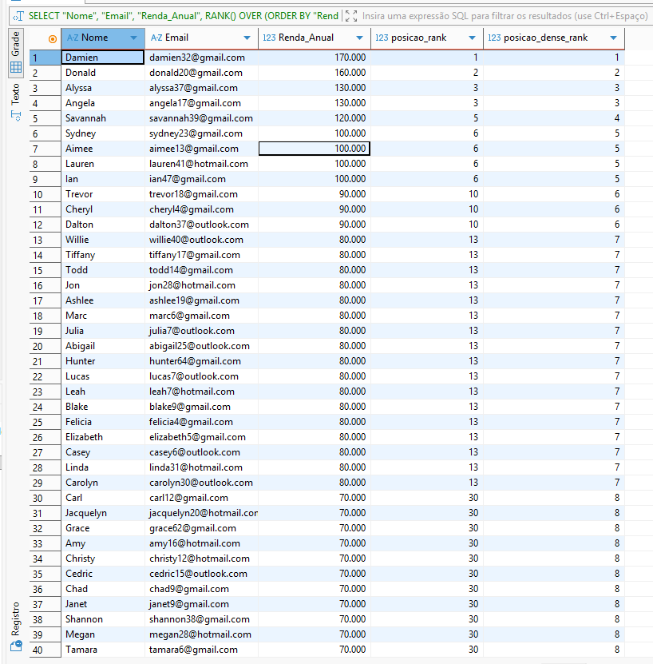
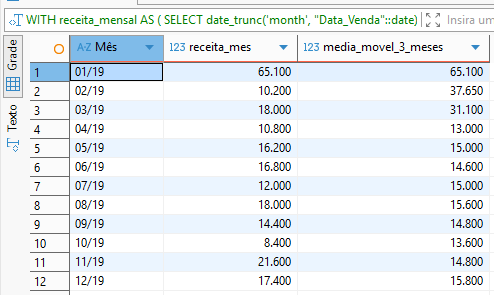
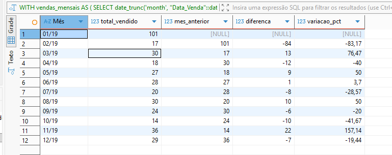
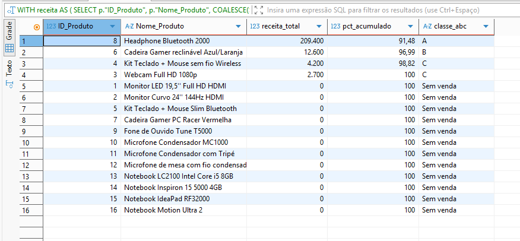
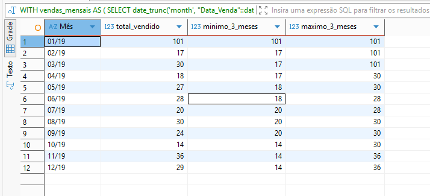
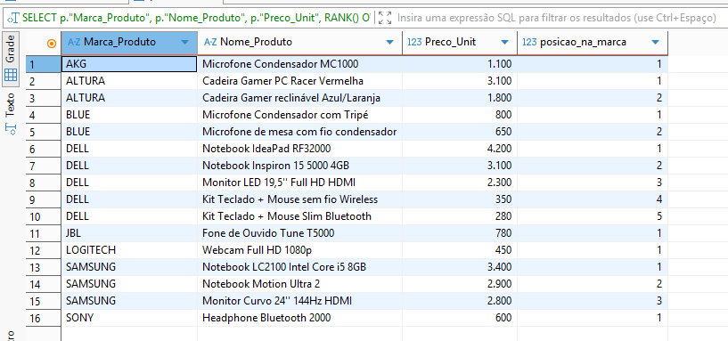

# Window Functions em SQL (PostgreSQL)

Coleção de consultas analíticas que resolvem perguntas reais de negócio sobre um banco de **vendas** (clientes, produtos e pedidos) usando **Window Functions** em PostgreSQL.

O foco não é só a sintaxe: cada arquivo parte de uma pergunta de negócio, explica a técnica e registra as armadilhas que evitei (ordenação de datas, `NULL` no ranking, empates em somas acumuladas, divisão por zero).

## O que está aqui

| Arquivo | Pergunta de negócio | Técnicas |
|---|---|---|
| [`00_criar_tabelas.sql`](00_criar_tabelas.sql) | Como recriar o banco para executar as consultas? | `CREATE SCHEMA`, `CREATE TABLE` |
| [`01_ranking.sql`](01_ranking.sql) | Quem são os clientes de maior renda? Como tratar empates? | `RANK`, `DENSE_RANK`, `ROW_NUMBER` |
| [`02_medias_moveis.sql`](02_medias_moveis.sql) | A receita está subindo ou caindo, sem o ruído mensal? | `AVG() OVER` com frame, `date_trunc` |
| [`03_lag_lead_comparacao_periodos.sql`](03_lag_lead_comparacao_periodos.sql) | Quanto variamos vs. mês anterior (MoM) e ano anterior (YoY)? | `LAG`, `LEAD`, `NULLIF` |
| [`04_acumulados_e_pareto.sql`](04_acumulados_e_pareto.sql) | Quanto já vendemos no acumulado? Quais produtos geram 80% da receita? | `SUM() OVER`, curva ABC com `CASE` |
| [`05_ntile_min_max.sql`](05_ntile_min_max.sql) | Como segmentar clientes por renda? Qual o menor/maior volume em 3 meses? | `NTILE`, `MIN/MAX OVER` |
| [`06_contribuicao_e_partition_by.sql`](06_contribuicao_e_partition_by.sql) | Quanto cada mês pesa no total? Qual o produto mais caro de cada marca? | `PARTITION BY`, `SUM(SUM()) OVER ()` |

## Modelo de dados

Schema `vendas`, com 6 tabelas (script de criação em [`00_criar_tabelas.sql`](00_criar_tabelas.sql)). As consultas deste repositório usam `clientes`, `produtos` e `pedidos`.

| Tabela | Colunas |
|---|---|
| `categorias` | `ID_Categoria`, `Categoria` |
| `clientes` | `ID_Cliente`, `Nome`, `Sobrenome`, `Data_Nascimento`, `Estado_Civil`, `Sexo`, `Email`, `Telefone`, `Renda_Anual`, `Qtd_Filhos`, `Escolaridade` |
| `locais` | `Cidade`, `Estado`, `Região` |
| `lojas` | `ID_Loja`, `Loja`, `Gerente`, `Endereco`, `Num_Funcionarios`, `Telefone` |
| `produtos` | `ID_Produto`, `Nome_Produto`, `ID_Categoria`, `Marca_Produto`, `Num_Serie`, `Preco_Unit`, `Custo_Unit` |
| `pedidos` | `ID_Pedido`, `Data_Venda`, `ID_Loja`, `ID_Produto`, `ID_Cliente`, `Qtd_Vendida`, `Receita_Venda`, `Custo_Venda`, `Custo_Unit`, `Preco_Unit` |

Relacionamentos (lógicos, sem chaves estrangeiras declaradas): `pedidos.ID_Cliente` → `clientes`, `pedidos.ID_Produto` → `produtos`, `pedidos.ID_Loja` → `lojas` e `produtos.ID_Categoria` → `categorias`.

`Data_Venda` é do tipo `text`; as consultas convertem para data com `::date`.

> Os nomes das colunas usam maiúsculas, por isso aparecem entre aspas duplas (`"ID_Produto"`). No PostgreSQL, identificadores sem aspas são convertidos para minúsculas.

## Decisões técnicas que fazem diferença

- **Ordem cronológica de meses:** agrupo com `date_trunc('month', ...)` e só formato com `to_char` no `SELECT` final. Ordenar o texto `'MM/YY'` coloca `01/26` antes de `12/25`.
- **`NULL` em ranking:** uso `COALESCE(SUM(...), 0)` ao usar `LEFT JOIN`; no `ORDER BY ... DESC` do Postgres, `NULL` vem primeiro e bagunçaria o Pareto.
- **Empates em acumulados:** uso frame explícito (`ROWS BETWEEN UNBOUNDED PRECEDING AND CURRENT ROW`) e desempate por ID, para a soma acumulada ser determinística.
- **Primeiro período do `LAG`:** deixo `NULL` em vez de `0`, pois não existe período anterior para comparar.
- **Divisão por zero:** `NULLIF(denominador, 0)` nas variações percentuais.

## Como executar

1. Tenha um PostgreSQL e um cliente SQL (DBeaver, pgAdmin ou `psql`).
2. Execute [`00_criar_tabelas.sql`](00_criar_tabelas.sql) para criar o schema `vendas` e as tabelas.
3. Carregue os dados executando os arquivos da pasta [`dados/`](dados/).
4. Abra os arquivos `01` a `06` e execute **uma consulta por vez**: cada arquivo contém várias, separadas por comentários numerados (`1.1`, `1.2`...).

## Resultados

Prints da execução no DBeaver.

### Ranking: RANK vs DENSE_RANK
Empates recebem a mesma posição; o `RANK` pula números e o `DENSE_RANK` não. No resultado, Alyssa e Angela empatam em 3º e, a partir do 5º lugar, os dois rankings divergem (5 no `RANK`, 4 no `DENSE_RANK`).

### Média móvel de 3 meses
Janeiro/19 (65.100) foi um pico isolado; a média móvel suaviza a série e, de abril em diante, oscila entre 13.000 e 15.800.

### Variação mês a mês (MoM)
Fevereiro/19 caiu 83,17% sobre janeiro (101 → 17 unidades) e novembro/19 teve a maior alta do ano: +157,14%.

### Curva ABC de produtos (Pareto)
A classe A reúne os produtos que compõem os primeiros 80% da receita; produtos sem nenhuma venda aparecem como "Sem venda". No resultado, o Headphone Bluetooth 2000 sozinho responde por 91,48% da receita, e 12 dos 16 produtos não tiveram nenhuma venda.

### Menor e maior volume numa janela de 3 meses

### Ranking de preço dentro de cada marca (PARTITION BY)
O ranking reinicia a cada marca.

## Ferramentas

PostgreSQL · DBeaver

## Autor

**Ronaldo** · [GitHub](https://github.com/Ronaldo-Scripth007)
